# AskPay XNK — Thiết kế hệ thống và kế hoạch hoàn thiện

## 1. Mục tiêu, phạm vi và trạng thái hiện tại

AskPay giúp doanh nghiệp xuất nhập khẩu tra cứu quy định hải quan, thuế, xuất xứ và nhãn hàng hóa theo ngày áp dụng; kết quả phải dẫn tới đúng văn bản, điều, khoản, điểm và bản nguồn. Sản phẩm giữ giao diện workspace hiện có và cung cấp bằng chứng để người dùng tự kiểm tra. Kiểm tra khớp trích dẫn không chứng minh câu trả lời đúng về mặt pháp lý.

Repo hiện là bản thử nghiệm gồm Next.js 14, FastAPI, snapshot corpus JSON, bộ tìm kiếm BM25, bộ kiểm tra trích dẫn và hai smart contract mẫu. FastAPI có bảy đoạn corpus demo; khi cấu hình snapshot thì chỉ trả các đoạn đã có ghi nhận rà soát, và phần trả lời hiện tại là extractive, không phải LegalQA sinh câu trả lời. Danh mục `research/legal-sources/manifest.json` chưa có importer đưa PDF/OCR thành snapshot provision; hiện chưa tìm thấy snapshot production trong repo. Tệp nguồn chưa có trạng thái xác minh chữ ký số. Endpoint không bật tiền. UI gửi `escrowTxHash` rỗng; proxy loại bỏ dữ liệu on-chain và đánh dấu phản hồi là demo. Không dùng bản này để tư vấn pháp lý hoặc nhận/hoàn tiền thật.

`research/legal-sources/manifest.json` ghi danh mục 44 văn bản: 43 mục có tệp đính kèm, tổng cộng 66 tệp đã qua kiểm tra URL/hash/metadata; `53/2026/VBHN-TT-BTC` chưa có tệp. Đây là phép kiểm tra metadata, không xác thực chữ ký số/nội dung. Tài liệu đầu vào gọi corpus là 30 văn bản nhưng các mã liệt kê đếm thành 31; danh mục nguồn lớn hơn phạm vi MVP. Chưa có snapshot pháp luật đã được chuyên gia duyệt và chưa có bộ câu hỏi đánh giá retrieval được gán nhãn độc lập. Không gán trạng thái hiệu lực hiện hành chỉ từ tên văn bản, OCR, website nguồn hoặc metadata do người nhập khai báo.

Thiết kế chia ba trạng thái dữ liệu rõ ràng:

| Trạng thái | Ý nghĩa | Được dùng để trả lời/thu tiền |
|---|---|---|
| `SOURCE_CAPTURED` | Đã lưu tệp và metadata nguồn; chưa tách hoặc soát nội dung | Không |
| `OCR_UNREVIEWED` | Có bản OCR theo trang, gắn SHA nguồn và cấu hình máy; có thể còn lỗi nhận dạng/bố cục | Không |
| `PROVISION_REVIEWED` | Từng phiên bản điều/khoản/điểm đã được người có thẩm quyền đối chiếu nguồn và thời gian hiệu lực | Chỉ được truy xuất; chưa tự cho phép settlement |

Các giá trị `REVIEW_ASSERTED`, `passed`, `VERIFIED_RELEASE` và điểm số hiện có không phải bằng chứng độc lập về danh tính người duyệt, hiệu lực pháp luật, tính đúng của câu trả lời hoặc điều kiện chi trả.

### Người dùng và phạm vi sản phẩm

Đối tượng chính là nhân viên khai báo hải quan/forwarder, pháp chế-kế toán XNK và SME cần tra cứu thuế, thủ tục, mã HS, C/O, chính sách mặt hàng, nhãn hàng hóa hoặc xử phạt. `quick` được thiết kế cho một câu hỏi/điều khoản trực tiếp; `deep` cho tình huống cần đối chiếu nhiều văn bản. Theo đặc tả sản phẩm, giá dự kiến là 0.05 USDC và 0.20 USDC tương ứng; cùng một chuẩn citation áp dụng cho cả hai, còn trả lời sâu phải có coverage evidence rộng hơn. Đây mới là giá mục tiêu, chưa dùng để thu phí vì contract hiện nhận AVAX và settlement đang tắt. Chuyển chuyên gia 5–20 USDC/48 giờ là roadmap, không phải tính năng hiện có.

Phạm vi MVP kỹ thuật là tra cứu extractive có nguồn, ngày áp dụng, bộ lọc provision đã rà soát và kiểm tra citation. Phân tích LegalQA sinh kết luận, fact-check văn bản người dùng dán, chuyên gia, x402, chi trả USDC và lời hứa “rủi ro bằng không” chỉ mở sau các cổng dữ liệu, đánh giá, pháp lý và thanh toán ở tài liệu này.

## 2. Nguyên tắc kiến trúc

1. **Bản gốc là nguồn đối chiếu.** PDF/HTML chính thức được lưu nguyên byte; OCR là bản chép phục vụ tìm kiếm và phải giữ liên kết về tệp, trang và vùng chữ.
2. **Không suy luận hiệu lực từ OCR.** Hiệu lực và lịch sử sửa đổi được biên tập theo từng phiên bản điều khoản, có khoảng ngày `[effective_from, effective_until)` và bằng chứng riêng.
3. **Đóng khi thiếu bằng chứng.** Snapshot hỏng, citation không tồn tại, ngày nằm ngoài `verified_through`, không đủ nguồn, validator lỗi hoặc dịch vụ không sẵn sàng đều không tạo kết quả đủ điều kiện settlement.
4. **Tách citation validation khỏi answer evaluation.** Bộ so chuỗi chỉ xác nhận một đoạn trích có mặt trong phiên bản nguồn; nó không chứng minh mọi nhận định trong câu trả lời được đoạn luật hỗ trợ.
5. **Giữ UI hiện tại.** Giữ ba cột, tông màu, vị trí panel, composer, session list, modal và breakpoint hiện hành. Mở rộng trạng thái và dữ liệu qua adapter; không đổi layout trong giai đoạn tích hợp backend.
6. **Một modular monolith trước.** Next.js là web/BFF; FastAPI là modular monolith cho corpus, retrieval và validation. Không thêm vector database, queue, framework hoặc model provider cho tới khi bộ đánh giá và tải thực tế chứng minh cần thiết.
7. **Không đưa bí mật lên client hoặc blockchain.** Câu hỏi/câu trả lời lưu ở ngoài chuỗi; nếu settlement được bật, chỉ ghi hash, mã tham chiếu tối thiểu và trạng thái giao dịch.

## 3. Kiến trúc đích

```mermaid
flowchart LR
    SRC[Portal chính thức] --> ACQ[Thu thập có allowlist]
    ACQ --> ART[Tệp nguồn bất biến + SHA-256]
    ART --> OCR[Tesseract OCR theo trang]
    OCR --> QUEUE[Hàng đợi biên tập / đối chiếu PDF]
    QUEUE --> SNAP[Snapshot điều khoản đã duyệt]
    SNAP --> IR[LegalIR: lọc theo ngày + BM25]
    IR --> QA[LegalQA extractive trước; model adapter sau]
    QA --> VAL[Validator độc lập]
    VAL --> API[FastAPI /api/v1/legal/*]
    API --> BFF[Next.js API proxy]
    BFF --> UI[Workspace AskPay hiện có]
    VAL -. settlement luôn tắt ở MVP .-> PAY[Payment orchestrator / oracle]
    PAY -. chỉ sau các cổng phê duyệt .-> CHAIN[Escrow + audit receipt]
```



### Ranh giới module

| Module | Trách nhiệm | Không được làm |
|---|---|---|
| `source_ingestion` | Chọn URL trong allowlist, tải tệp, ghi thời gian, MIME, dung lượng và SHA-256 | Đổi nội dung tệp, đánh dấu hiệu lực hoặc tự duyệt |
| `ocr` | Chạy Tesseract trên PDF, tạo record theo trang gồm line, bbox, confidence, engine/model metadata | Sửa văn bản thành “đúng luật” hoặc coi OCR là corpus đã duyệt |
| `editorial` | Gán điều/khoản/điểm, sửa lỗi bằng đối chiếu, lập quan hệ sửa đổi và quyết định rà soát | Ghi đè bản OCR gốc hoặc bỏ lịch sử người duyệt |
| `corpus` | Đọc snapshot bất biến, xác thực cấu trúc, khoảng hiệu lực, nguồn và hash | Trả phiên bản chưa được rà soát cho lookup pháp lý |
| `retrieval` | Lọc snapshot theo ngày và domain, tìm kiếm/xếp hạng ứng viên, lưu cấu hình retrieval | Tự kết luận hiệu lực hoặc bỏ qua điều kiện ngày |
| `answering` | Tạo nội dung chỉ từ evidence trả về; gắn citation cho từng mệnh đề pháp lý | Bịa căn cứ khi không tìm thấy evidence |
| `validation` | Xác nhận định danh, khoảng hiệu lực và phép so khớp excerpt; trả lý do từng citation | Gọi blockchain hoặc diễn giải điểm số thành xác suất đúng |
| `payment` | Chỉ ở giai đoạn sau: xác minh escrow event, orchestration, receipt và retry idempotent | Tin vào `passed` từ HTTP request của client |

FastAPI giữ hướng phụ thuộc `interfaces → application → domain`; `infrastructure` hiện thực file snapshot, HTTP/model adapter và blockchain adapter. Domain không import FastAPI, filesystem, RPC hay nhà cung cấp model. Các module không gọi trực tiếp lẫn nhau ngoài application service/contract đã định nghĩa.

Frontend giữ `app/` cho route/provider của Next.js; khi cần tách `page.tsx`, tổ chức các lát cắt theo FSD: `widgets/askpay-workspace`, `features/ask-question`, `features/select-tier`, `features/inspect-citation`, `features/open-corpus`, `entities/chat-session`, `entities/legal-citation`, `entities/corpus`, `shared/api`, `shared/ui`. Import chỉ đi từ lớp cao xuống lớp thấp; mỗi slice công khai qua `index.ts`. Tách dần qua adapter, không viết lại UI một lần.

## 4. Giao diện hiện có và ánh xạ dữ liệu

Nguồn UI chính là `app/page.tsx`, `app/components/RightPanel.tsx` và `app/data/legalWorkspaceData.ts`.

| Vùng UI hiện có | Dữ liệu/endpoint | Trạng thái cần biểu diễn |
|---|---|---|
| Sidebar, ví Fuji, nhãn DEMO, lịch sử phiên | `ChatSession`, trạng thái ví và giao dịch | `draft`, `answer_pending`, `answer_ready`, `error`; trạng thái ví không đồng nghĩa trạng thái trả tiền. Code hiện gán `verified/refunded` từ `validation.passed` dù không có giao dịch, cần bỏ cách gán này trước khi hiển thị lịch sử settlement |
| Chat center, ví dụ câu hỏi, composer | `POST /api/v1/legal/ask` qua Next proxy | loading, answer, không có nguồn phù hợp, lỗi dịch vụ, câu hỏi ngoài phạm vi |
| Nút gói `quick`/`deep` | `tier` | `quick`: top-k hẹp; `deep`: top-k rộng và tổng hợp nhiều căn cứ; hiện tại snapshot adapter lấy tối đa 8 ứng viên nhưng chỉ đưa 3 vào response, cần sửa trước khi tuyên bố deep đã hoạt động |
| Chế độ “Kiểm Chứng Luật” | Chưa có request schema riêng; hiện bị quy về `quick` trong `handleAsk` | Cần hợp đồng riêng cho văn bản cần fact-check trước khi bật; hiện phải gắn nhãn demo |
| Bubble câu trả lời, citation pill, badge | `answer`, `citations[]`, `validation` | Hiển thị “đoạn trích khớp” riêng với “đã chuyên gia rà soát”; không gọi là câu trả lời đúng hoặc đã xác thực pháp lý |
| RightPanel: `citation`, `document`, `experts` | Citation check, ngày, snapshot, source URL/SHA | Đang chọn citation; citation thiếu nguồn; không có citation; chuyên gia mẫu chưa xác nhận danh tính |
| Modal kho dữ liệu | `GET /api/v1/legal/corpus` | loading, lỗi, demo corpus, snapshot và số phiên bản đã ghi nhận rà soát |
| Modal lịch sử/settings/expert | `localStorage`, dữ liệu demo | Gắn nhãn dữ liệu lưu trên máy; chưa có tài khoản, hồ sơ chuyên gia xác minh hoặc giao dịch thật |

### Luồng người dùng và biên tập

1. **Tra cứu demo:** người dùng nhập tình huống, chọn quick/deep; UI ghi rõ demo/snapshot status và trả đoạn trích cùng link nguồn khai báo. Không hỏi ví và không thu/hoàn tiền.
2. **Tra cứu có snapshot:** người dùng chọn ngày áp dụng; backend lọc phiên bản trước retrieval. OCR chưa duyệt không được đưa vào kết quả. Nếu không có provision đủ bằng chứng, API trả no-result/abstain. Chọn citation mở panel phải với văn bản nguồn, URL, SHA và ngày.
3. **Kiểm chứng văn bản dán:** hiện chưa được hỗ trợ đúng nghĩa; UI mode `factcheck` gửi nội dung dán vào `/ask`. Khi triển khai, mode này cần nhận `answer_text` và citations có cấu trúc, gọi `/validate` hoặc endpoint fact-check riêng, rồi trả trạng thái theo từng citation/claim. Nếu không có citation có cấu trúc, kết quả là “không đủ dữ liệu để kiểm chứng”.
4. **Chuyển chuyên gia:** card hiện là dữ liệu mẫu. Luồng thật cần hồ sơ xác minh, lĩnh vực, đồng ý chia sẻ nội dung, quote phí, SLA, trạng thái nhận việc và xử lý hoàn phí riêng; không tính đây là câu trả lời LegalQA.
5. **Duyệt văn bản:** operator ghi nhận nguồn/hash; editor đối chiếu OCR và tách provision; reviewer độc lập rà nguồn, chronology và ngày áp dụng; publisher tạo snapshot bất biến. Xung đột giữa nguồn, bản hợp nhất, văn bản sửa đổi hoặc phụ lục đưa hồ sơ về trạng thái chưa xác minh.
6. **Settlement tương lai:** chỉ bắt đầu sau khi người dùng chấp thuận quote và escrow đã final; câu trả lời, validation, receipt và settlement có trạng thái riêng như phần 8. Không gộp nó vào luồng tra cứu demo.

### Hợp đồng UI không phá vỡ tương thích

- Giữ các trường đang được UI dùng: `question_id`, `tier`, `answer`, `citations`, `validation.passed`, `validation.overall_score`, `validation.citation_checks` và metadata nguồn.
- Chỉ thêm trường tùy chọn như `answer_method`, `corpus_status`, `snapshot_id`, `snapshot_sha256`, `as_of`, `validator_version`, `model_version`, `settlement_status`. Không đổi tên trường hoặc ý nghĩa cũ trong response hiện tại.
- `overall_score` là tên trường đang chạy và là tên canonical; một đoạn trong tài liệu đầu vào dùng `overall_confidence` nhưng ví dụ API/UI không dùng tên đó. Không đổi tên để tránh hỏng UI và không gọi score này là xác suất.
- Giữ ba trục độc lập trong state/UI: `citation_check_status` (`PASS|FAIL|NOT_RUN`), `legal_review_status` (`UNREVIEWED|REVIEWED_WITH_EVIDENCE|EXPIRED_REVIEW`) và `settlement_status` (`DISABLED|NOT_STARTED|PENDING|RELEASED|REFUNDED|RECONCILIATION`). Không dùng `validation.passed` để kết luận tiền đã release/refund.
- UI hiển thị trạng thái tiền riêng với trạng thái citation. Trong MVP, trạng thái luôn `DISABLED`; không dựng `onchain` proof giả.
- Lỗi mạng/API phải hiện cảnh báo và giữ bản nháp câu hỏi; không đổi lỗi thành câu trả lời mẫu hay danh sách văn bản tĩnh.
- `localStorage` hiện lưu toàn bộ nội dung phiên ở trình duyệt. Trước vận hành B2B phải có lựa chọn lưu/xóa rõ ràng, thời hạn lưu và cảnh báo không nhập bí mật thương mại nếu chưa có chính sách lưu trữ.

## 5. REST API và tương thích schema

FastAPI hiện có ba endpoint pháp lý trong `ai-service/main.py`; Next.js dùng `app/api/ask-and-settle` như BFF tương thích và `app/api/legal-corpus` để nạp danh mục.

### `POST /api/v1/legal/ask`

Request hiện có: `question_id`, `question`, `tier: quick|deep`, `domain: import_export_customs`, `as_of` tùy chọn; cờ `simulate_hallucination` và `simulate_expired_law` chỉ dành cho demo. Model Pydantic hiện mặc định `question_id` là `0x00`; production phải yêu cầu ID duy nhất và ràng buộc với request idempotency/quote. Trong môi trường thật, cờ mô phỏng phải bị từ chối. Endpoint `/validate` hiện chưa được Next proxy/UI gọi; chế độ “Kiểm Chứng Luật” đang gửi văn bản dán vào `/ask` như câu hỏi thường.

Response giữ cấu trúc cơ bản:

```json
{
  "question_id": "<id duy nhất>",
  "tier": "quick",
  "answer": "Các đoạn có từ khóa liên quan...",
  "citations": [
    {
      "document": "128/2020/NĐ-CP",
      "document_title": "Nghị định ...",
      "article": "9",
      "clause": "1",
      "point": "",
      "excerpt": "Nguyên văn đã đối chiếu với phiên bản nguồn"
    }
  ],
  "validation": {
    "passed": false,
    "verdict": "UNVERIFIED_REFUND",
    "settlement_eligible": false,
    "corpus_status": "OCR_UNREVIEWED",
    "snapshot_id": "snapshot id",
    "snapshot_sha256": "sha256 manifest",
    "as_of": "YYYY-MM-DD",
    "validator_version": "version",
    "citation_checks": []
  },
  "answer_method": "EXTRACTIVE",
  "payment_status": "DISABLED",
  "hashes": {},
  "latency_ms": 0
}
```

Giá trị trong ví dụ là hình thức schema, không phải kết quả hay tuyên bố corpus đã đạt. Validator không được trả `settlement_eligible: true` trong giai đoạn hiện tại.

### `POST /api/v1/legal/validate`

Nhận danh sách citation và `as_of`; chạy cùng implementation validator với `/ask`. Response gồm kết quả theo từng citation, lý do thất bại, nguồn và hash snapshot. Request validation độc lập không thể cấp quyền settlement.

### `GET /api/v1/legal/corpus`

Trả `snapshot_id`, `snapshot_sha256`, `corpus_status`, số văn bản, số phiên bản khoản, số phiên bản có ghi nhận rà soát và danh sách văn bản. `reviewed_versions` luôn được diễn giải là metadata rà soát do hệ thống ghi nhận, không phải chứng nhận hiệu lực.

### Quy ước hợp đồng

- Response thành công có `question_id` khớp request và citations/checks phải cùng định danh document/article/clause/point; đây là kiểm tra hiện có của BFF.
- Chuẩn hóa lỗi thành `{ "error": { "code": "...", "message": "...", "request_id": "..." } }` ở phiên bản hợp đồng mới; khi chưa nâng version, giữ `{error: string}` để UI cũ không lỗi.
- Dùng UTC timestamp cho sự kiện hệ thống, ISO date cho ngày hiệu lực và timezone `Asia/Ho_Chi_Minh` khi mặc định ngày hỏi.
- Giới hạn kích thước câu hỏi/citations, timeout, pagination và rate limit được cấu hình ở BFF; không log nội dung câu hỏi trong log vận hành.
- API thật cần authentication và authorization. CORS allow-all trong cấu hình demo hiện tại không phải cấu hình production.

## 6. Corpus, thu thập nguồn và Tesseract

### Quy trình dữ liệu

1. Lấy metadata từ domain allowlist: `vanban.chinhphu.vn`, `vbpl.vn`, `congbao.chinhphu.vn`, `phapdien.moj.gov.vn`, `vntr.moit.gov.vn` và domain Bộ Công Thương được duyệt.
2. Giữ nguyên từng tệp tải, URL trang và URL tệp, thời điểm lấy, kích thước, MIME, tên gốc, chữ ký số nếu có thể kiểm tra, SHA-256 và trạng thái kiểm tra. Không giải nén RAR nhiều phần nếu chưa đủ part và không rõ thứ tự.
3. Tệp PDF có text layer được bóc text nhưng vẫn đối chiếu render; PDF scan đi qua OCR. Cả hai đường đều tạo bản trích xuất chưa duyệt.
4. Tách Điều → Khoản → Điểm theo cấu trúc văn bản. Lưu vị trí trang/vùng chữ và văn bản trước/sau chỉnh sửa; mọi sửa tay tạo bản mới và có người ghi nhận.
5. Biên tập viên đối chiếu từng provision với PDF/bản ký số; chuyên gia rà soát quan hệ sửa đổi, thay thế, bãi bỏ và mốc hiệu lực. Chỉ snapshot được duyệt mới xuất bản.
6. Đóng gói manifest và source artifacts thành snapshot bất biến; kiểm tra hash, trùng mã, trùng khoảng thời gian, thiếu bằng chứng và lỗi nguồn trước khi atomically đổi phiên bản đang phục vụ.

### OCR bằng Tesseract

Mã `ai-service/ocr_tesseract_batch.py` gọi Tesseract 5.5.4 cùng `vie+eng`, render 150 DPI, OEM 1, PSM 3; record lưu SHA nguồn, SHA từng file `traineddata`, engine/version, `tsv_parser_version`, bbox, confidence, trang và `review_status: UNREVIEWED`. Parser version 2 tách từng dòng TSV theo tab với cột cuối giữ nguyên để dấu nháy kép OCR không gộp các dòng tiếp theo; regression test tái hiện trường hợp này. Mã nguồn Tesseract được tải/build ngoài repo tại `../third_party/tesseract`; không commit binary hoặc model vào repo. Môi trường triển khai phải cài đúng binary và model, kiểm tra version/hash lúc khởi động.

Kiểm tra lượt Tesseract đầu cho thấy parser CSV cũ đã gộp TSV thô vào text ở 15/166 trang của Nghị định 18/2021 và 30/266 trang của Nghị định 126/2020; riêng hai bộ này có khoảng 120 nghìn và 316 nghìn ký tự TSV bị lẫn. Không dùng các output đầu làm corpus. Parser v2 được kiểm thử trước và toàn bộ bộ Tesseract được chạy lại; sau audit coverage/hash, chỉ bản parser v2 được giữ làm bản chuẩn.

Đợt OCR hiện tại bao phủ 11 nghị định, 13 PDF và 880/880 trang. Kiểm tra toàn bộ xác nhận SHA-256 từng nguồn khớp trên cả trang, số trang liên tục, metadata Tesseract 5.5.4/parser v2/model hashes đồng nhất và không còn tab/newline/TSV thô trong line text. Đây là độ phủ và tính toàn vẹn kỹ thuật; mọi trang vẫn `UNREVIEWED` cho tới khi được đối chiếu nội dung.

Các output Tesseract được lưu trong thư mục `ocr-tesseract-*` riêng, không ghi đè EasyOCR. Giữ một JSON mỗi trang để batch có thể tiếp tục theo checkpoint, đối chiếu trang đơn và giữ metadata cục bộ; không nén hoặc gộp chúng thành corpus text duy nhất. Nếu cần backup vận chuyển, tạo archive phụ từ snapshot đã kiểm tra, còn PDF gốc và JSON chuẩn vẫn giữ nguyên. Phép kiểm tra phát hành OCR gồm: đủ chính xác số trang PDF; page number duy nhất và liên tục; SHA mọi page bằng SHA nguồn; metadata engine/model giống nhau; trang review phủ đủ; spot-check trang đầu/giữa/cuối, trang bảng/phụ lục và vùng chữ ký. Các kiểm tra này xác nhận provenance và coverage, không xác nhận OCR đúng từng chữ. Mọi trang vẫn `UNREVIEWED` cho tới khi được biên tập viên đối chiếu.

### Mô hình dữ liệu logic

| Entity | Trường cốt lõi |
|---|---|
| `LegalDocument` | `document_id`, title, issuer, document type, issue date, source system |
| `SourceArtifact` | URL, retrieved time, MIME, size, SHA-256, signature-check result, file path |
| `OCRPage` | source SHA, page number/count, OCR engine/version, traineddata hashes, DPI, bbox, text, confidence, review state |
| `ProvisionVersion` | document, article, clause, point, text, page refs, effective-from/until, amendment relation |
| `ReviewDecision` | provision/version hash, reviewer identity/role, reviewed-at, verified-through, evidence URL, decision and note |
| `CorpusSnapshot` | snapshot id, manifest SHA-256, build time, included provision versions, validation result |
| `RetrievalRun` | request id, as-of date, snapshot hash, tier, query hash, candidates/ranks and retrieval configuration |
| `AnswerRun` | question id, answer method/model version, answer hash, citation ids, latency and failure/abstention reason |
| `ValidationRun` | validator version, snapshot hash, per-citation gates, excerpt metric, verdict; never a legal opinion |
| `EscrowAttempt` | question id, asker, tier, token, chain, contract, amount, question hash, transaction/finality and state |
| `SettlementReceipt` | answer/validation hashes, snapshot/validator versions, settlement result, transaction ids and idempotency key |

MVP lưu trữ vẫn là immutable JSON snapshot như `ai-service/legal_corpus.py` hỗ trợ; chưa cần database mới. Nếu editor workflow hoặc số lượng snapshot vượt giới hạn vận hành, chuyển riêng lớp infrastructure sang database qua interface, không thay domain/API contract.

## 7. LegalIR, LegalQA và citation validator

### Retrieval

- Chọn phiên bản theo `as_of` trước khi xếp hạng: `effective_from <= as_of < effective_until` và `as_of <= verified_through`; `effective_until: null` không tự chứng minh còn hiệu lực.
- Giữ chunk theo provision pháp lý, không cắt giữa câu/khoản; passage giữ đường dẫn document → article → clause → point và vị trí nguồn.
- MVP dùng BM25 hiện có trên snapshot đã rà soát. `quick` lấy top-k hẹp (3); `deep` lấy top-k rộng (8) và phải thực sự đưa đủ evidence liên quan vào tổng hợp. Sửa mismatch hiện tại: `snapshot_api.ask_snapshot` tìm 8 ứng viên deep nhưng chỉ trả 3.
- Bộ đánh giá gán nhãn độc lập theo domain và thời điểm; đo recall@3/8, MRR, no-result accuracy, citation coverage và lỗi nhầm phiên bản. Chia train/dev/test theo câu hỏi và thời gian để tránh rò rỉ điều khoản gần trùng. Có thể dùng mốc đề xuất ban đầu Recall@3 ≥ 0.90, Recall@8 ≥ 0.95, MRR@8 ≥ 0.85, no-result accuracy ≥ 0.98 làm tiêu chí thử nghiệm; chuyên gia nghiệp vụ phải duyệt hoặc điều chỉnh các mốc này trước khi dùng làm cổng phát hành.
- Chỉ thêm dense/vector search hoặc reranker khi benchmark cho thấy BM25 không đạt ngưỡng do chủ sở hữu sản phẩm/chuyên gia phê duyệt; khi đó version hóa model, embeddings, tokenizer và cấu hình xếp hạng.

### Answering

- Trước mắt, trả trích đoạn nguyên văn có dẫn nguồn; nêu rõ đây là kết quả truy xuất, không phải tư vấn. Không đưa một đoạn trích đơn thành câu trả lời kết luận vượt quá nội dung điều khoản.
- Giai đoạn LegalQA sinh câu trả lời chỉ mở sau corpus duyệt và benchmark. Mỗi mệnh đề pháp lý phải gắn ít nhất một provision/version; giữ câu trả lời không có căn cứ ở dạng abstain.
- Deep chỉ tổng hợp các evidence tìm thấy; nêu xung đột/điều kiện/quan hệ sửa đổi, trích dẫn từng nhận định và không lấp phần thiếu bằng kiến thức model.
- Model là adapter thay thế được; nhà cung cấp, nơi xử lý dữ liệu, retention, chi phí và phiên bản phải được duyệt trước khi gửi câu hỏi khách hàng.

### Validator và semantics

Mỗi câu trả lời muốn có verdict citation-pass phải có ít nhất một citation. Với mọi citation: (1) document có trong snapshot; (2) đúng article/clause/point; (3) có phiên bản đã rà soát, còn nằm trong khoảng hiệu lực và trong `verified_through` tại ngày hỏi; (4) excerpt có ít nhất 10 từ và đạt ngưỡng similarity `>= 0.90` theo implementation đã version hóa. Một citation fail làm toàn câu trả lời `UNVERIFIED`. So khớp phải dùng source text của đúng provision version, không phải text do model trả lại.

`overall_score` là điểm phép kiểm tra theo trọng số 25/25/20/30 trong đặc tả hiện có; không được gắn nhãn confidence/probability. Partial-ratio phải bị giới hạn khi excerpt dài hơn source để tránh việc một đoạn ngắn khớp một phần rồi thêm chữ khác mà vẫn qua. `/ask` và `/validate` gọi cùng implementation Python. Không nhân đôi logic bằng TypeScript.

Citation pass không kiểm chứng suy luận/diễn giải, điều kiện ngoại lệ, độ đầy đủ của căn cứ hoặc hiệu lực pháp lý ngoài snapshot. Muốn đánh giá các yếu tố đó cần bộ test claim-level có chuyên gia gán nhãn và quy trình kiểm soát độc lập; không suy ra điều này từ ngưỡng 90%.

## 8. Thanh toán, escrow và biên lai

### Trạng thái hiện tại

Trong code, `AskPayEscrow.sol` nhận AVAX native, không nhận USDC; giá `0.005/0.02 ether` chỉ là giá trị demo, không tương đương bảo đảm giá USDC. Contract chấp nhận trả thừa so với giá tier; `owner` cũng có thể gọi `resolveQuestion`, verdict/điểm do oracle truyền vào và không được contract kiểm tra theo ngưỡng 90%; chưa có ràng buộc question hash với nội dung xử lý ngoài dữ liệu do caller cung cấp. UI không gọi `askQuestion`; `escrowTxHash` đang rỗng; API proxy bỏ `onchain`. `AskPayReceiptLog.sol` cho phép ghi đè cùng `questionId` và tăng counter lại. Tài liệu BA nêu địa chỉ Own L1/chain ID 663010 trong khi deploy script hiện đặt receipt chain theo Fuji 43113; mọi địa chỉ và network phải xác minh từ deployment artifact/RPC trước khi tin dùng. Oracle key, contract verification, ERC-20, x402 và cross-chain recovery chưa hoàn thiện. Vì vậy giữ settlement tắt.

### Luồng đích khi được bật

1. BFF tạo quote chứa `question_id` duy nhất, question hash canonical, tier, chain id, token/decimals, số tiền chính xác, escrow address, deadline và snapshot policy; quote có thời hạn và idempotency key.
2. Ví người dùng ký escrow đúng token, số tiền, question id và hash. Không gửi câu hỏi thô lên chain.
3. Backend đọc transaction/event từ RPC tin cậy, xác nhận chain, contract, asker, tier, amount, question hash, receipt success và finality. Client tự khai transaction hash không đủ làm bằng chứng.
4. Backend chạy retrieval, QA và validator với snapshot đã pin theo quote; kết quả giữ `snapshot_sha256`, `validator_version`, `answer_hash`, `citations_hash`.
5. Nếu có audit L1 riêng, worker ghi receipt trước settlement; ghi idempotent theo question id và kiểm tra finality. Hỏng một chain thì giữ trạng thái `PENDING_RECONCILIATION`; không báo đã hoàn tất.
6. Chỉ oracle service riêng mới được resolve escrow sau khi xác minh quote, kết quả, snapshot policy và receipt. Failure/abstain/timeout đi theo nhánh refund; client không được gửi `passed=true` hay điểm.
7. UI chờ event/receipt cuối cùng và hiển thị transaction thật, trạng thái đang xử lý hoặc lỗi đối soát. Không tự sinh transaction hash.

### Máy trạng thái cần triển khai

`QUOTED → ESCROW_PENDING → ESCROW_CONFIRMED → ANSWER_PENDING → VALIDATED → RECEIPT_PENDING → SETTLEMENT_PENDING → RELEASED | REFUNDED_INVALID | REFUNDED_TIMEOUT`; lỗi RPC/chain sau khi đã gửi giao dịch thành `PENDING_RECONCILIATION`. Mỗi chuyển trạng thái idempotent; cùng event được xử lý nhiều lần không tạo thanh toán/biên lai thứ hai.

Trước tiền thật phải thống nhất token, chain, x402 version/provider, decimals, contract addresses, timeout/finality, oracle key custody, treasury, quy trình nâng cấp/khẩn cấp và chính sách tranh chấp. Contract cần kiểm soát token/amount chính xác, chống reentrancy, chống resolve lặp, giới hạn quyền owner/oracle, xử lý token lỗi, kiểm tra receipt, bảo vệ duplicate question ID và được audit độc lập. Mạng testnet không đủ để tuyên bố an toàn production.

## 9. Bảo mật, riêng tư và vận hành

- Định danh vai trò: người dùng; biên tập viên; reviewer/chuyên gia; operator; service account; oracle signer. Người sửa dữ liệu không tự phê duyệt provision của chính mình ở quy trình thật.
- BFF xác thực request, giới hạn kích thước/tần suất, chống replay và khóa truy cập dịch vụ nội bộ. Secrets chỉ nằm ở secret store/runtime server; khóa oracle không nằm trong client, log hoặc repo.
- Mặc định không gửi nội dung câu hỏi/citation lên chuỗi. Log dùng request id, hash, tier, snapshot/model version, latency và error code; nội dung chỉ lưu theo retention đã công bố.
- Snapshot xuất bản bất biến, ký/đối chiếu hash trong pipeline; rollback về snapshot trước phải có người vận hành và audit event.
- Health/readiness tách khỏi trạng thái corpus; 503 khi manifest hỏng, checksum lệch, model/engine không đúng hoặc snapshot không nạp được.
- Theo dõi độ trễ từng bước, tỉ lệ no-result, citation failure reason, corpus freshness, queue review, RPC lag, pending settlement và retry. Cảnh báo không chứa câu hỏi nhạy cảm.
- Backup gồm tệp nguồn, manifest, quyết định biên tập, snapshot và audit trail; kiểm thử khôi phục checksum định kỳ.
- Có nút dừng generation và settlement riêng. Tắt settlement không được ảnh hưởng khả năng đọc corpus hoặc xem kết quả demo.

## 10. Kế hoạch triển khai và điều kiện hoàn thành

Mỗi giai đoạn giữ phạm vi nguyên tử; test hợp đồng trước implementation và chỉ chuyển giai đoạn khi đạt DoD. Repo chưa cần thêm thư viện cho tài liệu, OCR hiện tại hoặc snapshot JSON.

### Giai đoạn A — Chuẩn hóa đầu vào OCR và nguồn

**DoD:** mọi PDF trong phạm vi được chọn có manifest nguồn, byte/hash và page count xác định; OCR được lưu thành output mới, đủ trang, metadata nhất quán, không ghi đè bản cũ. Mọi trang chưa soát còn `UNREVIEWED`.

**Kiểm chứng:** hash toàn bộ source; so page count với PDF; xác nhận page index liên tục, cấu hình Tesseract/model hashes đồng nhất; render review batch đủ trang; kiểm tra trang đầu/giữa/cuối và trang có bảng/chữ ký.

**Tình huống biên:** PDF nhiều part, trang trắng, OCR rỗng, dấu mộc, bảng nhiều cột, checkpoint sai model/source, tiến trình dừng giữa chừng. Lệnh phải tiếp tục cùng cấu hình hoặc từ chối checkpoint không tương thích; không xóa bản nguồn.

### Giai đoạn B — Corpus phiên bản và biên tập pháp lý

**DoD:** phạm vi corpus được chốt rõ số mã; mỗi văn bản có source artifact; mọi provision được gắn định danh, text đối chiếu, thời gian hiệu lực và quan hệ sửa đổi; snapshot vượt source/hash/overlap validation; có audit người duyệt và `verified_through`.

**Kiểm chứng:** test contract cho manifest; ca hiệu lực quá khứ/hiện tại/tương lai, hết hiệu lực một phần, sửa đổi một phần, chồng lấn thời gian, URL/hash sai, thiếu bằng chứng; chuyên gia ký biên bản rà soát mẫu và phê duyệt toàn bộ nội dung đưa vào snapshot.

**Tình huống biên:** nguồn không truy cập được, văn bản hợp nhất và văn bản sửa đổi mâu thuẫn, chuyển tiếp, quy định hồi tố, thiếu phụ lục hoặc bản dịch. Hạ về `UNVERIFIED`, không tự chọn câu trả lời.

### Giai đoạn C — Retrieval và LegalQA

**DoD:** bộ câu hỏi holdout do người hiểu nghiệp vụ gán nhãn; retrieval quick/deep đạt các ngưỡng được product owner và chuyên gia duyệt trước khi đo; câu ngoài phạm vi và ngày không có provision phải abstain; mọi nhận định pháp lý có citation.

**Kiểm chứng:** báo cáo recall@k, MRR, no-result accuracy, citation coverage theo domain/ngày; test amendment, query rewrite, nhiều luật cùng đề tài, câu hỏi thiếu dữ kiện và yêu cầu dựa vào luật hết hiệu lực.

**Tình huống biên:** nguồn tranh chấp, câu hỏi mơ hồ, không có kết quả, hai quy định khác thời điểm, model timeout, output không schema, câu trả lời có nhận định không được trích dẫn. Không sinh kết luận khi evidence thiếu.

### Giai đoạn D — API, validator và UI

**DoD:** OpenAPI/JSON contract giữ trường hiện có; BFF kiểm tra schema; `/ask` và `/validate` cho kết quả validator giống nhau trên cùng citation/snapshot/ngày; UI giữ layout hiện tại và phân biệt rõ citation match, corpus review và payment state.

**Kiểm chứng:** test boundary excerpt 9/10 từ, similarity dưới/đúng/trên 0.90, citation rỗng, document/article/clause/point sai, nhiều citation có một citation fail, ngày sát `effective_from`, `effective_until`, `verified_through`; UI kiểm tra loading, no-result, 503, malformed response, mobile và reset dữ liệu demo.

**Tình huống biên:** FastAPI chậm/mất kết nối, response lệch question id, source URL thiếu, snapshot đổi trong lúc request, localStorage lỗi/quota đầy. UI không dựng trạng thái thành công hoặc payment proof.

### Giai đoạn E — Payment testnet và audit

**DoD:** token/chain/contract cụ thể được phê duyệt; escrow event khớp quote; không thanh toán nếu corpus/QA/validator không đạt cổng; duplicate event không resolve hai lần; timeout/refund/reconciliation hoạt động; audit hợp đồng độc lập không còn lỗi nghiêm trọng.

**Kiểm chứng:** contract/integration test cho sai chain, sai token/amount/asker/tier/hash, replay, receipt fail, oracle timeout, L1 down, giao dịch thành công một phần, retry, token callback, finality chậm, wallet từ chối và người dùng rút timeout. Chỉ kiểm thử testnet; không deploy mainnet trong giai đoạn này.

**Tình huống biên:** RPC phân nhánh hoặc trễ, một giao dịch đã thành công còn giao dịch kia pending, oracle mất key, owner đổi cấu hình, token không chuẩn ERC-20. Chuyển sang reconcile/manual pause; không tự gắn nhãn release/refund đã xong.

### Giai đoạn F — Phát hành và vận hành

**DoD:** runbook nêu cách deploy/rollback, snapshot publication, key rotation, incident response, retention, backup/restore và owner; metric/alert được thử; nhánh tích hợp sạch và tương thích UI/API.

**Kiểm chứng:** restore snapshot từ backup có hash khớp; rollback không đổi dữ liệu gốc; kiểm tra quota/timeout/rate-limit; rà quyền truy cập và log; kiểm tra luồng responsive. Test implementation chạy theo kế hoạch QA đã được yêu cầu cho mỗi lần phát hành.

## 11. Quyết định còn mở trước khi tuyên bố production

1. Danh sách văn bản MVP chính xác: “30 văn bản” trong đặc tả không khớp các mã liệt kê; xác định xử lý văn bản sửa đổi, FTA, văn bản hết hiệu lực và `53/2026/VBHN-TT-BTC` chưa tải được.
2. Nguồn trạng thái hiệu lực ưu tiên và người chịu trách nhiệm rà soát; quy trình xác thực danh tính/chuyên môn reviewer.
3. Quy tắc citation score: giữ 10 từ tối thiểu, cách đo similarity và việc “citation match” không thay thế claim-level support.
4. Bộ đánh giá và ngưỡng chấp nhận retrieval/answer quality; ngưỡng phải được duyệt trước khi đánh giá holdout.
5. Model/provider hoặc tiếp tục extractive; chi phí, nơi xử lý câu hỏi và retention.
6. Chính sách dữ liệu câu hỏi và local history; thời gian lưu, quyền xóa/xuất và thông báo người dùng.
7. Nếu dùng tiền thật: token, chain, x402 implementation/provider, giá, contract addresses, oracle custody, treasury, finality, timeout, refund và dispute policy.
8. Điều kiện đưa AskPay từ công cụ tra cứu hỗ trợ sang tư vấn hoặc cam kết hoàn phí; cần review pháp lý và bảo hiểm/trách nhiệm tương ứng trước khi đưa ra lời hứa thương mại.

## 12. Tài liệu trong repo

- `REST_API_SPEC_FOR_RAG_TEAM.md`: mục tiêu sản phẩm, corpus dự kiến, validator và REST API đầu vào.
- `docs/KHO_LUAT_PHIEN_BAN.md`: manifest snapshot, date semantics, review metadata và giới hạn validator hiện tại.
- `research/DANH_MUC_NGUON_LUAT.md`: danh sách URL/tệp nguồn đã thu thập và các quan hệ cần rà soát.
- `PRODUCT_OVERVIEW_FOR_BA.md`: mô tả pitch sản phẩm; các cam kết về “rủi ro bằng 0”, USDC, settlement và hiệu lực phải được xem là giả định/roadmap cho tới khi các cổng trong tài liệu này đạt.
- `ai-service/ocr_tesseract_batch.py`: tạo bản OCR theo trang gắn nguồn/model metadata; không duyệt nội dung.
